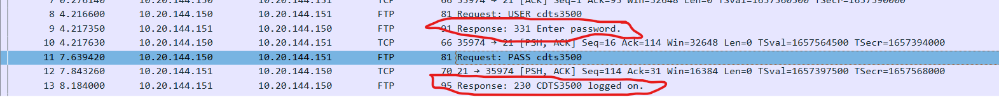
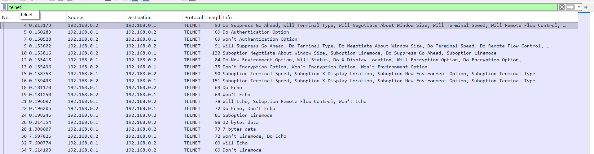
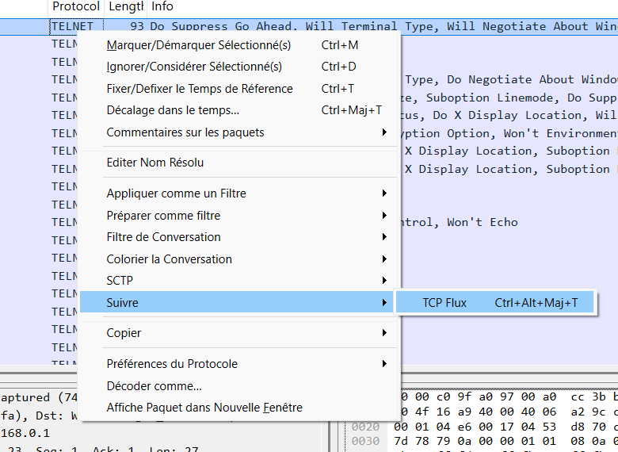
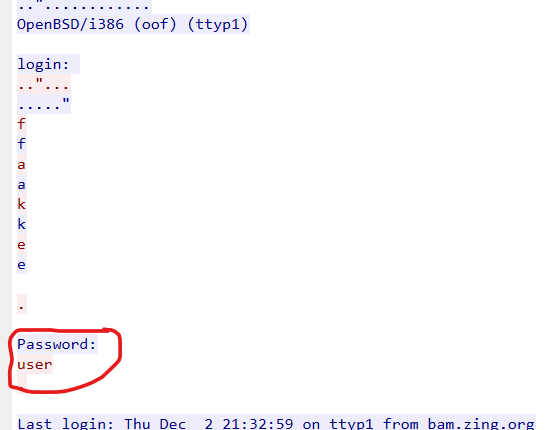
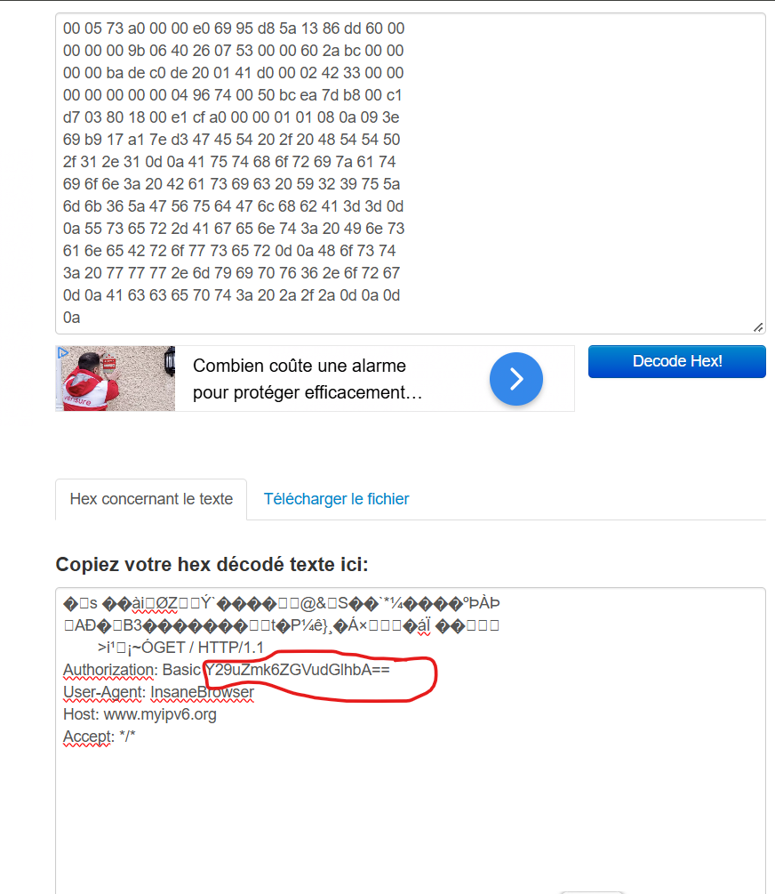
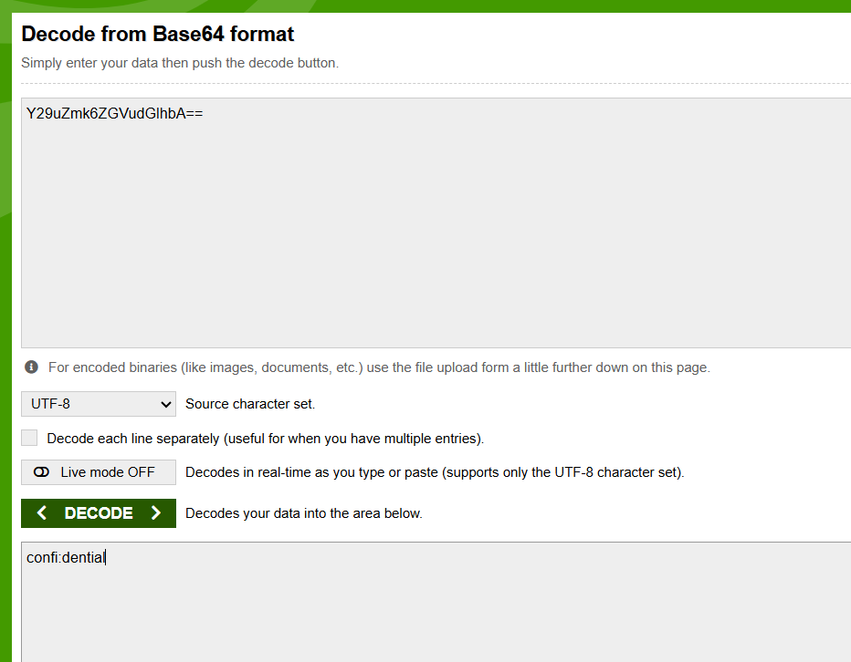
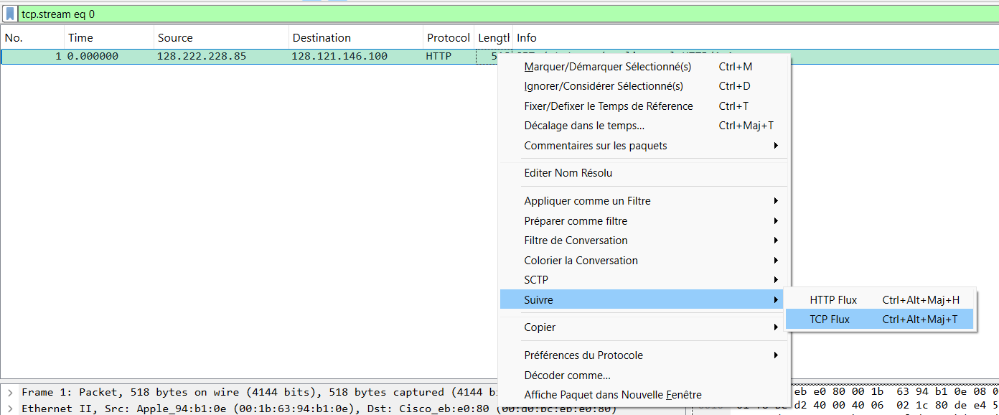

# Compte Rendu de TP — Sécurité Réseau & Analyse de Captures

---

## 1. FTP - Authentification

* **Objectif** : Retrouver le mot de passe d'un utilisateur lors d'un échange authentifié réalisé via le protocole FTP.
* **Explication théorique** : Le protocole FTP (RFC 959) transmet toutes les données d'authentification en clair (unencrypted). L'analyse des paquets permet de lire directement les identifiants en passant par les commandes du protocole.
* **Méthodologie** : 
  1. Ouverture de la capture sous Wireshark.
  2. Filtrage des paquets TCP sur le service FTP (port 21).
  3. Reconstitution du flux de contrôle pour identifier les commandes `USER` et `PASS`.



* **Analyse de la capture** : Isolation de la session de connexion et extraction du mot de passe utilisateur transmis en clair sur le réseau.

---

## 2. TELNET - Session / Authentification

* **Objectif** : Retrouver le mot de passe de l'utilisateur à partir d'une capture réseau d'une session Telnet.
* **Explication théorique** : Le protocole Telnet (RFC 854) est un protocole de terminal virtuel non sécurisé. Contrairement à SSH, il n'utilise aucun chiffrement : chaque caractère saisi sur le terminal est envoyé en clair dans la charge utile TCP.
* **Méthodologie** :
  1. Ouverture de la capture dans Wireshark.
  2. Utilisation de la fonctionnalité *Follow TCP Stream* (Suivre le flux TCP) pour réassembler la totalité de la session interactive.



* **Analyse de la capture** : La chaîne globale de la session fait apparaître la mire de connexion ainsi que le mot de passe saisi par l'utilisateur.

---

## 3. ETHERNET - Trame

* **Objectif** : Retrouver les données confidentielles dissimulées ou transmises au sein d'une trame Ethernet brute.
* **Explication théorique** : Une trame Ethernet (RFC 1042) constitue l'unité de base de la couche liaison de données (Couche 2 OSI). Lorsque les données ne sont pas chiffrées aux couches supérieures, l'inspection brute de la charge utile de la trame permet d'extraire directement les informations confidentielles.
* **Méthodologie** :
  1. Chargement du fichier de capture dans Wireshark.
  2. Inspection du panneau de détails et du champ hexadécimal/ASCII des trames brutes.



* **Analyse de la capture** : Lecture et extraction de l'information confidentielle directement contenue dans la charge utile (*payload*) de la trame.

---

## 4. Authentification Twitter

* **Objectif** : Retrouver le mot de passe utilisateur à partir d'une capture réseau d'authentification.
* **Explication théorique** : Lors de requêtes d'authentification via un protocole Web non sécurisé (HTTP au lieu de HTTPS), les identifiants envoyés via la méthode POST sont visibles en clair dans le corps de la requête.
* **Méthodologie** :
  1. Appliquer un filtre d'affichage HTTP dans Wireshark (`http.request.method == "POST"`).
  2. Analyser les paramètres contenus dans le formulaire d'envoi de la requête web (`HTML Form URL Encoded`).



* **Analyse de la capture** : Extraction des champs d'authentification et identification du mot de passe associé au compte utilisateur.

---

## 5. Configuration Cisco - Mots de Passe (Type 7 & Type 5)

* **Objectif** : Analyser un fichier de configuration d'un équipement Cisco pour extraire et décasser les mots de passe.
* **Explication théorique** :
  * **Cisco Type 7** : Simple masquage basé sur un algorithme XOR à clé fixe. Totalement réversible.
  * **Cisco Type 5** : Hachage de type MD5-Crypt (reconnaissable au préfixe `$1$`) qui intègre un sel (*salt*). Contrairement aux hachages simples, il nécessite des outils prenant en charge les formats salés.
* **Méthodologie** :
  1. Décodage immédiat de la chaîne Type 7 via un décodeur Cisco XOR.
  2. Analyse du hash Type 5 : constat de l'échec sur les outils non-salés (ex. CrackStation), puis cassage réussi par dictionnaire avec un outil adapté au `md5crypt` (John the Ripper / Hashkiller).



* **Analyse de la capture** : Récupération des deux mots de passe en clair à partir des données extraites du fichier `.cfg`.

---

## 6. IP - Time To Live (TTL)

* **Objectif** : Déterminer la valeur du champ TTL (*Time To Live*) de la dernière requête ICMP (*Echo Request*) ayant permis d'atteindre l'hôte cible.
* **Explication théorique** : Le champ TTL de l'en-tête IPv4 empêche les paquets de tourner en boucle sur le réseau. Dans une analyse de type *Traceroute*, le TTL est incrémenté progressivement de 1 jusqu'à atteindre l'hôte de destination.
* **Méthodologie** :
  1. Filtrer les paquets ICMP dans Wireshark (`icmp`).
  2. Identifier la dernière requête `Echo (ping) request` transmise avant l'atteinte de la cible.
  3. Analyser la structure de l'en-tête Internet Protocol Version 4 du paquet.



* **Analyse de la capture** : Sélection du paquet n° 75 et lecture directe du champ **Time to Live**, indiquant une valeur finale égale à **13**.

---

## 7. DNS - Transfert de Zone (AXFR)

* **Objectif** : Exploiter une mauvaise configuration d'un serveur DNS pour effectuer un transfert de zone (`AXFR`) non authentifié et récupérer le flag.
* **Explication théorique** : Le transfert de zone (AXFR) permet de répliquer la totalité des enregistrements DNS entre serveurs. S'il n'est pas restreint aux serveurs secondaires autorisés, n'importe quel attaquant peut télécharger l'ensemble de la cartographie DNS du domaine.
* **Méthodologie** :
  1. Résolution des contraintes environnementales (PowerShell / `cmd` / `nslookup`).
  2. Installation de l'outil `dig` sous Windows (via BIND).
  3. Exécution de la commande AXFR sur le port personnalisé `54011` :
     ```cmd
     dig @challenge01.root-me.org -p 54011 ch11.challenge01.root-me.org AXFR
     ```



* **Analyse de la capture** :
  * **Commande (surlignée en violet)** : `dig @challenge01.root-me.org -p 54011 ch11.challenge01.root-me.org AXFR`
  * **Résultat (surligné en rouge)** : Récupération de l'enregistrement TXT contenant le secret : `CBkFRwfNMMtRjHY`.

